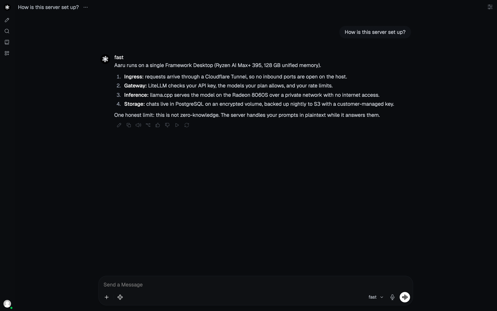
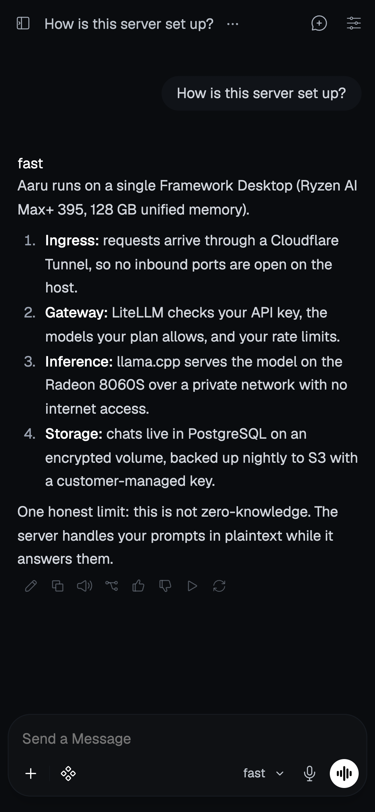

# aaru-web

The web chat app for [Aaru](https://github.com/CorpLynx/aaru), a self-hosted, invite-only AI
inference platform running open-weight models on a Framework Desktop. It installs on phones as a PWA.

> [!NOTE]
> **Based on [Open WebUI](https://github.com/open-webui/open-webui).** This codebase started from
> Open WebUI 0.12.3 and is now maintained as a standalone project that will diverge from it. Open
> WebUI is created by Timothy Jaeryang Baek and the Open WebUI contributors; their work is the
> foundation of everything here. What Aaru changed is listed in [`AARU.md`](AARU.md).

<table>
  <tr>
    <td width="70%"></td>
    <td width="30%"></td>
  </tr>
</table>

## What Aaru changes

- **Theme and branding:** the Aaru design tokens, self-hosted Geist and JetBrains Mono, a dark-only
  theme, and the Aaru name, logo, splash and PWA manifest.
- **Image pipeline:** `.github/workflows/aaru-image.yaml` builds one linux/amd64 image, runs it as a
  non-root user, blocks fixable critical and high Trivy findings, and publishes
  `ghcr.io/corplynx/aaru-web`.
- **Planned:** removing cloud and frontier-model inference so the app talks only to Aaru's own
  gateway, and the screens in the [design handoff](https://github.com/CorpLynx/aaru/tree/main/design).

Deployment, the gateway, the model servers and the build specification live in
[`CorpLynx/aaru`](https://github.com/CorpLynx/aaru).

## Development

Requires Node 18–22 and Python 3.11.

```sh
npm ci
NODE_OPTIONS=--max-old-space-size=8192 npm run build
```

Before pushing, run `npm run format` and `npm run i18n:parse`; CI fails if either changes files.

Production images are built by GitHub Actions, not locally. From the `CorpLynx/aaru` repo root,
`infra/scripts/build-openwebui-image.sh` tags the current commit, waits for the build, and pins the
image digest in the Quadlet unit.

### Upstream fixes

There are no automatic merges from Open WebUI. Security fixes are cherry-picked by hand from the
`upstream` remote; see [`AARU.md`](AARU.md#upstream).

## License

This code is distributed under the [Open WebUI License](LICENSE) (see also
[`LICENSE_HISTORY`](LICENSE_HISTORY) and [`LICENSE_NOTICE`](LICENSE_NOTICE)): BSD-3-Clause terms
plus a branding clause. Aaru's rebrand relies on clause 4(i), which permits it for deployments with
at most 50 end users in any rolling 30-day period. Geist and JetBrains Mono are under the SIL Open
Font License 1.1 (`static/assets/fonts/*-OFL.txt`).
